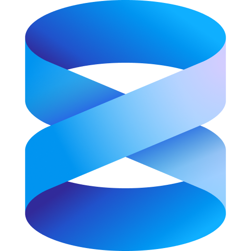

<h1>
    👋 Hello there
</h1>
  
 
About me: 
 - 🖥 ITSM 
 - 🎓 Engineering 
 - 📊 Data science 
 

<!--

 -->

## Skills

 
    
  <tr>
    <td></td>
    <td></td>
    <td></td>
    <td></td>
    <td></td>
    <td></td>
    <td></td>
    <td></td>
    <td></td>
    <td></td>
    <td></td>
    <td></td>
    <td></td>
    <td></td>
    <td></td>
    <td></td>
  </tr>

## Github Stats

  

